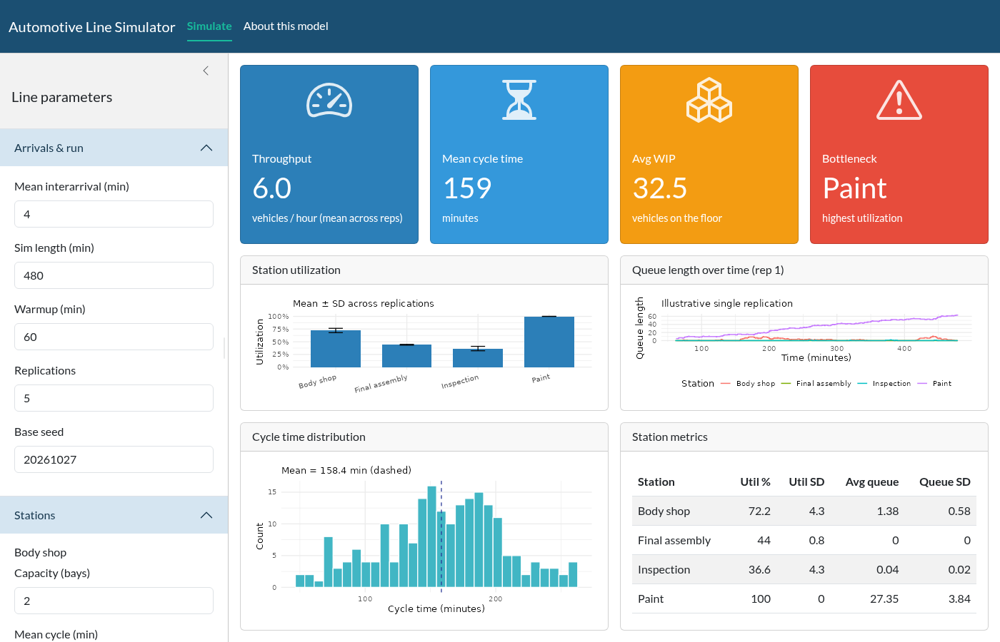
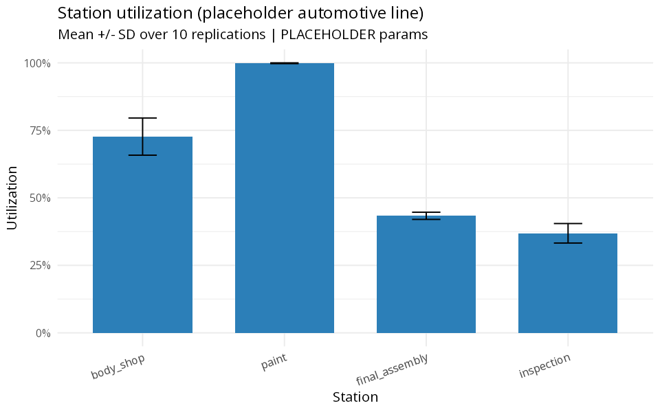
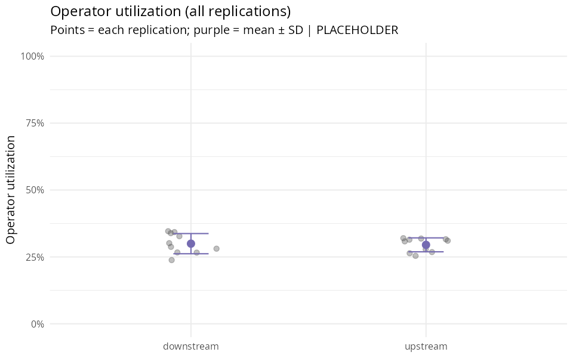
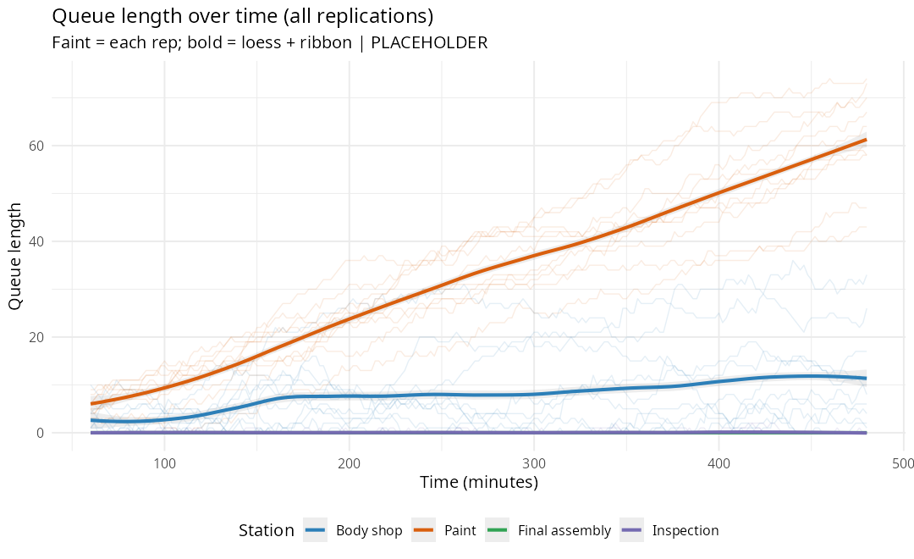
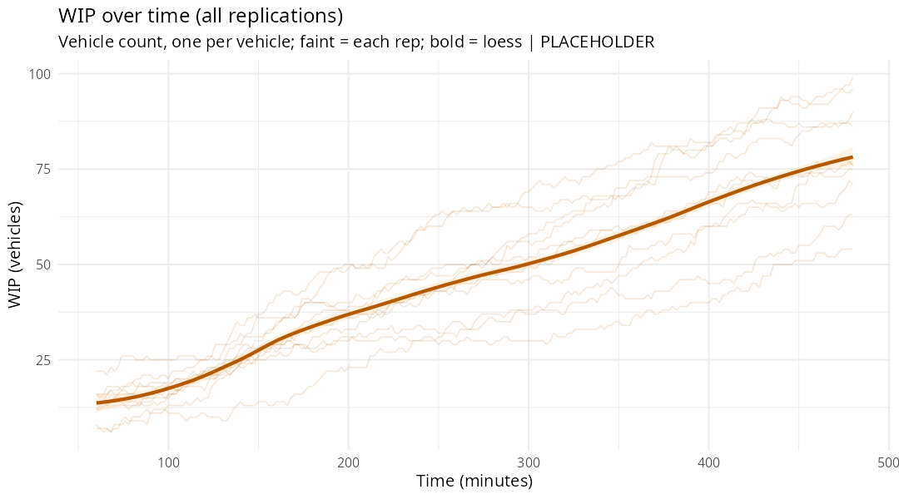
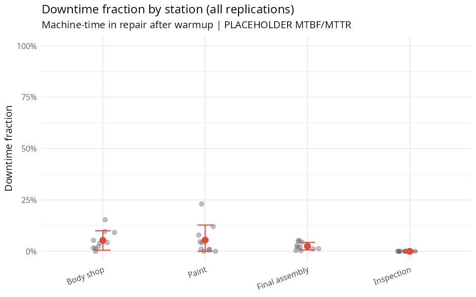
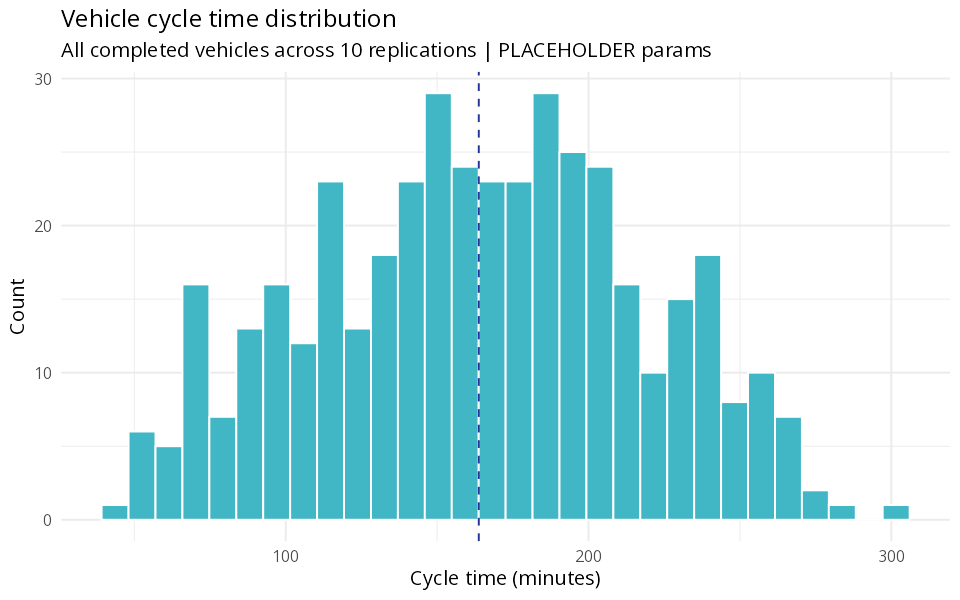

# Automotive Line Simulation

Discrete-event simulation of a serial automotive manufacturing line, written in R with [simmer](https://r-simmer.org/). Vehicles arrive and flow through four stations:

**Body shop → Paint → Final assembly → Inspection**

The same engine drives a Shiny app, a Quarto document with `server: shiny`, and batch scripts. Operators, support work, and equipment reliability are part of the model. Charts and CSV exports use every replication.

> **Placeholder example values.** Capacities, crew sizes, cycle times, MTBF/MTTR, and support-task times shipped here are examples chosen so the demo runs quickly and shows a paint-bay bottleneck candidate. They are not real plant data. Results are illustrative only and are not predictions for any employer. Replace them with measured station data before using any result to make a decision.

## Live demos

| Surface | Link |
| --- | --- |
| Shiny app | <https://2o6mmo-eddie-benjamin.shinyapps.io/automotive-line-sim/> |
| Quarto document | <https://2o6mmo-eddie-benjamin.shinyapps.io/automotive-line-sim-quarto/> |

Deployment contents may differ from this development branch. No automatic deployment is performed by these changes. See [DEPLOY.md](DEPLOY.md).



## What the model does

A vehicle occupies a bay while an operator loads it, an automatic cycle runs, and an operator unloads it. The operator is released during the automatic cycle. The bay stays occupied, including while the vehicle waits for an operator or for automatic capacity.

Operator pools can be two shared zones (body + paint, and assembly + inspection), one shared team, or a dedicated crew per station. Support work either arrives on an exponential interval or runs after every N completed operations at that station, and it uses the same operators. Count-triggered support happens after the bay is released.

Each station has a pool of interchangeable automatic units equal to its bay count. Independent failure processes interrupt that pool. Unfinished automatic processing resumes after repair. Up-time clocks advance during idle and busy time and pause during that unit's own repair. MTBF here is mean calendar up-time. MTTR is mean active repair time. Waiting for a shared repair technician adds downtime. Failures do not consume production operators. Loading and unloading are not interrupted by automatic-unit failures.

Activity times (load, automatic, unload, support) can be fixed, drawn from a normal, lognormal, or exponential distribution, or sampled from pasted observations. Normal draws are floored at zero, so the entered mean and SD describe the underlying normal. Lognormal mean and SD are the minutes of the positive duration.

Each replication uses seed `base_seed + replication - 1`. Statistics below use the window after warmup:

- Throughput counts departures in the window, including vehicles that arrived during warmup.
- Cycle time uses that same departure cohort.
- WIP is the integral of each vehicle's time in the system. A vehicle counts once even when it holds several resources.
- Bay occupancy and queue length integrate the piecewise-constant resource monitor, including the state carried across the warmup boundary.
- Downtime fraction is machine-time in repair inside the window, divided by capacity times the window length. The repair-event log keeps start time and sampled duration for the whole run.

The **bottleneck candidate** now uses bay occupancy excluding blocked time. This prevents a full upstream station blocked by downstream congestion from automatically ranking highest. Remaining operator/equipment waits can still affect the score; confirm a constraint through a capacity-change experiment.

Placeholder defaults (all example values):

| Station | Bays | Automatic distribution | Mean (min) | SD | Zone | Load / unload (min) | MTBF / MTTR (min) | Support interval / duration (min) |
| --- | ---: | --- | ---: | ---: | --- | --- | --- | --- |
| Body shop | 2 | exponential | 6 | — | upstream | 1 / 0.5 | 240 / 15 | 60 / 4 |
| Paint | 1 | normal | 8 | 1.5 | upstream | 0.5 / 0.5 | 360 / 20 | 90 / 5 |
| Final assembly | 2 | normal | 7 | 1.0 | downstream | 2 / 1 | 300 / 10 | 45 / 4 |
| Inspection | 1 | exponential | 3 | — | downstream | 1 / 0.5 | off (`MTTR` 0) | 60 / 3 |

The Shiny defaults are one 480-minute measured shift after 300 minutes of settling (780 minutes total), 15 evenly scheduled orders/hour, entrance-space admission with three waiting positions, and three waiting positions before each downstream station. The CONWIP limit, used only when that admission policy is selected, defaults to 20 vehicles. Two operators per zone and one repair technician. The app, the Quarto doc, and the batch script default to 32 replications. Base seed is `20261027`. The queue and WIP charts resample monitors onto a 2-minute grid. Random support is on; "every N units" defaults to 0, which selects the random interval.

## Features

- Serial four-station line with parallel bays.
- Shared zones, one shared team, or dedicated operators. Load and unload hold an operator; the automatic cycle does not.
- Support work on a random interval or every N units.
- Equipment failures with per-station MTBF/MTTR and a shared repair crew.
- Fixed, distribution, or empirical activity timing, plus a variability comparison that holds expected task time constant.
- Staffing comparison: current crews, one extra operator on the first or last team, and the same headcount in one shared team, with a 95% Student-t interval for mean throughput.
- All-replication charts: a bay-occupancy boxplot with one point per replication; operator-utilization and downtime densities overlaid by category, with a rug tick per replication and a vertical line when every replication is identical; faint queue and WIP lines with a loess ribbon; faint per-replication cycle-time densities plus the pooled density.
- CSV download for each table and a **Download all (zip)** bundle.
- **Compare two sets:** two independently editable parameter snapshots, imported from the main controls. Charts use every replication. Summary metrics, bay occupancy, operator utilization, and active repair are overlaid densities with a rug tick per replication. CSV files sit with the comparison tables.
- Self-contained `app/` and `quarto/` directories, each publishable with `rsconnect`.

## KPIs

| KPI | Definition in this model |
| --- | --- |
| Throughput | Departures per hour after warmup |
| Labor productivity | Throughput per operator on the clock |
| Cycle time | Departure minus arrival for vehicles that finish in the window. The chart shows each replication's density and the pooled density |
| Average WIP | Time-weighted vehicles in the system, counted once. The time series is that count on the grid |
| Queue length | Time-weighted bay queue, and queue over time for every replication |
| Bay occupancy | Time-weighted busy bays / capacity. The chart is a horizontal boxplot with one point per replication, in the station's color |
| Operator utilization | Time-weighted busy operators / pool size. The chart is an overlaid density across replications, with a rug tick per run and a vertical line when every replication matches |
| Downtime fraction | Repair machine-time in the window / (capacity × window). The chart is an overlaid density across replications, with a rug tick per run and a vertical line when every replication matches |
| Bottleneck candidate | Station with the highest mean bay occupancy |

### Example plots

The figures under `docs/images/` that are named like the batch outputs were generated by an earlier run of `scripts/manufacturing_sim.R`. The script now uses the 32-replication default, including failures and two operator zones. `deploy_app.png`, `deploy_quarto.png`, and `app_screenshot.png` are the earlier hosted UI.













### Exports

The Shiny app (**Lead time & data → Downloads**) and the Quarto document each offer a CSV per table, plus **Download all (zip)**. The batch script writes the same files to `output/` and bundles them as `output/sim_exports.zip`.

| File | Contents |
| --- | --- |
| `queue_timeseries.csv` | Resampled bay queue and servers by replication, seed, station, and time |
| `wip_timeseries.csv` | Resampled vehicle count (each vehicle once) by replication, seed, and time |
| `utilization_by_rep.csv` | Time-weighted bay occupancy, queue, and servers for each replication and station |
| `cycle_times.csv` | One row per departure in the observation window |
| `station_metrics.csv` | Across-replication mean and SD of occupancy, queue, and downtime fraction |
| `run_parameters.csv` | Horizon, seeds, crew pools, and each station's capacity, timing, MTBF/MTTR, and support settings |
| `downtime_by_rep.csv` | Repair minutes, repair count, and downtime fraction by replication and station |
| `repair_events.csv` | One row per repair: station, start time, sampled duration, replication |
| `failure_events.csv` | One row per failure occurrence over the whole run |
| `operator_by_rep.csv` | Time-weighted utilization and queue for each operator pool and replication |
| `summaries.csv` | Per-replication throughput, cycle-time quantiles, WIP, and labor productivity |

`run_line_sim()` returns those tables directly, plus the raw bay monitor for every replication (`resources_ts`), the arrival log used for WIP, labor rows, and the headline means and SDs.

## Tech stack

| Piece | Role |
| --- | --- |
| R | Runtime. This repo was exercised with the Ubuntu R 4.3 package; the portfolio target is R 4.5 |
| [simmer](https://r-simmer.org/) | Discrete-event engine |
| tidyverse | Wrangling and ggplot2 figures |
| tidymodels | Listed for later modeling work. The simulation does not call it |
| shiny, bslib, bsicons | Interactive app and Quarto document |
| DT | Metrics and scenario tables |
| zip | **Download all** bundle and `sim_exports.zip` |
| Quarto (`server: shiny`) | Interactive document |
| rsconnect | Deploy to shinyapps.io or Posit Connect |

## Run locally

```r
install.packages(c(
  "simmer",
  "tidyverse",
  "tidymodels",
  "shiny",
  "bslib",
  "bsicons",
  "DT",
  "zip",
  "rsconnect"
))
```

Quarto CLI is required only for the document: <https://quarto.org/docs/get-started/>.

### Shiny app

```bash
Rscript -e 'shiny::runApp("app")'
```

The app runs once on load, then again when you press **Run simulation**. KPI boxes stay above three result tabs (Bottleneck & capacity, Flow over time, Lead time & data), each with full-width charts. **Compare staffing scenarios** opens Bottleneck & capacity → Staffing comparison. **Compare timing variability** opens Lead time & data → Timing comparison. CSVs are under Lead time & data → Downloads.

### Quarto document

```bash
cd quarto
quarto preview line_sim.qmd
```

The document exposes the same staffing, reliability, timing, plot, and download controls.

### Batch scripts

From the repository root:

```bash
Rscript scripts/manufacturing_sim.R
Rscript scripts/staffing_experiments.R
Rscript scripts/timing_experiments.R
Rscript tests/model_checks.R
Rscript tests/shiny_checks.R
Rscript tests/timing_checks.R
Rscript tests/comparison_checks.R
```

`manufacturing_sim.R` sources `app/R/model.R`, runs the 32-replication default, and writes `output/*.csv`, `output/sim_exports.zip`, and the PNG figures (`utilization`, `operator_utilization`, `queue_length`, `wip_over_time`, `downtime`, `cycle_time_dist`). The script resolves `output/` from its own path. `output/` is gitignored.

The staffing and timing scripts use 20 replications and write comparison CSVs plus RDS archives of the nested scenario results.

## Deploy

`app/` and `quarto/` each carry their own `R/model.R`:

```r
# working directory app/
rsconnect::deployApp(appDir = ".", appName = "automotive-line-sim")

# working directory quarto/
rsconnect::deployDoc("line_sim.qmd", appName = "automotive-line-sim-quarto")
```

Account setup is in [DEPLOY.md](DEPLOY.md). Keep `rsconnect/` and any `.Renviron` or `.env` files out of git.

If you change the engine, copy it before the next publish:

```bash
cp app/R/model.R quarto/R/model.R
```

`tests/model_checks.R` fails if the two copies differ.

## Project structure

```text
app/
  app.R                 # bslib Shiny app (staffing, reliability, plots, downloads)
  R/model.R             # simmer engine, deployed with the app
  R/comparison.R        # Compare two sets page
quarto/
  line_sim.qmd          # same controls, server: shiny
  R/model.R             # identical engine copy
scripts/
  manufacturing_sim.R   # default-replication batch: CSVs, zip, PNGs
  staffing_experiments.R
  timing_experiments.R
tests/
  model_checks.R
  shiny_checks.R
  timing_checks.R
  comparison_checks.R
docs/images/            # earlier UI screenshots and batch example plots
DEPLOY.md
COLLABORATION.md
LICENSE                 # MIT, Eddie Benjamin, 2026
```

## Roadmap

- Replace placeholder capacities, crews, cycle times, and MTBF/MTTR with measured station data.
- Finite buffers and blocking.
- Shift calendars and planned downtime.
- Rework loops and scrap.
- Sensitivity checks that confirm a bottleneck candidate by moving throughput.
- Independent random streams so scenario comparisons are paired.

## License

[MIT](LICENSE) © 2026 Eddie Benjamin.

## Two editable parameter sets (Shiny)

Open **Compare two sets** in the top navigation. On the first visit, both sets
are imported from the current main-page controls, including changes not yet run.
They then remain independent: editing the main page does not silently overwrite
the comparison. Use **Import main settings into both sets** to replace both drafts,
or **Copy Set 1 to Set 2** to restart the study from the edited baseline. These
buttons intentionally replace the destination settings. A separate button matches
only Set 2's replication count to Set 1 without changing the treatment.

All editor sections start collapsed. Each set exposes run settings, pool staffing,
station assignments/capacities, activity timing (including full empirical vectors),
and reliability/support triggers. Count 0 removes an unused operator pool; an
assigned pool must have at least one operator. Unconstrained labor can be selected
explicitly per station.

**Run comparison** freezes the inputs and results for both sets. A prominent notice
marks old charts when drafts change. Parameter differences show the current drafts;
charts and the RDS download describe the captured run. Failed validation leaves
the last successful results intact and reports that the comparison was not updated.

Blue is Set 1 and orange is Set 2 throughout the comparison, including when the
titles are renamed. Headline cards report means, the descriptive Set 2 minus Set 1
difference, and percent change where the baseline is nonzero. Throughput, mean lead
time, WIP, output per operator-hour, bay occupancy, operator utilization, and active
repair fraction are overlaid densities with a rug tick for every replication. A set
with no spread is a vertical line at that value. Occupancy stays inside 0–100%, and
other non-negative metrics start at zero. Lead-time density curves pool every
completed departure. WIP and queue charts draw every replication as a faint line,
with a loess ribbon per set on that set's own time grid. Missing or no-completion
metrics remain unavailable. Results are illustrative only and are not predictions
for any employer.

The throughput table gives 95% Student-t intervals for each set's mean. It does not
provide a confidence interval for the difference. Equal base seeds do not establish
synchronized event random streams or justify a paired inference. Differences in
horizon, warmup, replications, or arrival rates are explicitly flagged. Active repair
fraction retains the engine's existing definition and excludes technician waiting.

CSV files on **Tables & download** repeat the data behind each comparison chart
(both sets, every replication). Download **both runs and exact inputs (.rds)** to
retain complete timing vectors, parameters, replication outputs, and the capture
timestamp. This is a Shiny page. The Quarto document keeps its existing controls
and comparison presets. A stale comparison keeps the previous charts, marks them,
and offers **Rerun comparison**. Each captured set shows the same run-settings
summary as the Simulate page.

Validation: `Rscript tests/comparison_checks.R` exercises import/reset, editable
controls, identical-set agreement, independent edits, stale results, copying,
matching replication counts, empirical validation, and all comparison plots/tables.
Existing model, timing, and Shiny checks also pass. Browser layout and mobile visual
QA are still required before deploying this development branch.

## Production schedule, buffers and admission (new development)

The Shiny app separates **Initial settling period**, **Shift duration**,
**Number of measured shifts**, and **Simulation runs**. Total operating time is
`settling + shift_duration * shifts`. For example, 1,440 minutes of settling,
480 minutes per shift, 20 shifts and 25 runs simulates 25 independent periods of
184 operating hours each, reporting the final 160 hours as twenty separate shifts.
Shifts are **consecutive production periods**, not a wall-clock weekday calendar.
Work, repairs and failure clocks continue across shift boundaries; there are no
nights/weekends/breaks in this release. A long settling period does not guarantee
stationarity or remove an overloaded order backlog.

A planned order is created at the configured vehicles/hour rate, either evenly
spaced (first at time zero) or at exponential intervals. This is incoming planned
work, not a modeled customer due-date/demand forecast. Its admission rule is:

- **Entrance space:** admit FIFO only when a first-station bay or entrance waiting
  position is available. Further orders wait outside production.
- **CONWIP:** require entrance space AND a free place under the total line WIP cap.
- **Release all scheduled work:** admit immediately, permitting an unlimited
  entrance queue. Interstation buffer limits still apply. Backlog is intentionally
  relocated into shop-floor WIP in this policy, not silently dropped.

Every downstream station has `buffer_before` waiting positions, additional to its
bays. Zero permits direct transfer only. A completed upstream vehicle must reserve
a downstream bay-or-buffer slot before its own bay is released (**blocking after
processing**). The slot remains allocated until the vehicle leaves that downstream
station. Operators are released after unloading and are not held during blocking.
Count-triggered support tasks retain their prior after-bay-release behavior and
can delay transfer while holding a reserved downstream position. This is an
explicit reservation assumption, not instantaneous transporter modeling.

`orders` keeps order time, release time, completion time and status. Unreleased
orders are excluded from shop-floor WIP; their waiting is included in
order-to-completion lead time. Production lead time starts at release. Both
lead-time means use completed departure cohorts and remain subject to finite-run
censoring. No end-of-run draining is performed. Incoming work that remains outside
production at the end is still visible as backlog.

`shift_summaries` contains one row per shift per run: planned orders, admissions,
completions, throughput, starting/ending WIP and backlog, average WIP, and both
lead-time means. Shifts use half-open intervals `[start,end)`; beginning stocks are
measured immediately before events at the boundary. This gives exact balances:

```
start WIP + admissions - completions = end WIP
start backlog + planned orders - admissions = end backlog
```

The **Production schedule & flow** page shows shift output, admitted WIP versus
unreleased work, station waiting durations, and active repair versus technician
waiting. Total equipment unavailability includes ongoing failures still waiting
for repair at run end. Existing repair-fraction charts retain the narrower active
repair metric. Blocked, operator-wait and automatic-capacity-wait minutes are
recorded directly; they are not a full mutually exclusive processing/starvation/
failure state decomposition. Automatic processing interrupted by a breakdown is
covered by reliability losses, not the automatic-capacity queue-wait metric.

Comparison sets expose the same new controls, track their changes in provenance,
and include shift-output and unreleased-backlog charts. The existing scalar
`sim_length_min` remains a derived total horizon in shift mode. Programmatic old
parameter lists without `time_mode` use `legacy`: the old total horizon minus
warmup is one measured period. Legacy lists missing `buffer_before` retain
unlimited internal queues. The Quarto UI still uses this legacy run configuration;
its engine copy is kept identical, but the new production UI is Shiny-only.

New exports: `shift_summaries.csv`, `orders.csv`, `release_timeseries.csv`, and
`station_waits.csv`. The full RDS comparison export retains every new table and
exact inputs. Existing flat empirical timing labels remain summaries; use the RDS
for exact replay of empirical vectors.

Checks: `tests/production_checks.R` exercises shift partitions, vehicle/order
conservation, zero-buffer blocking, entrance limits, event-level CONWIP bounds,
24-hour settling plus 20-shift measurement, empty runs and repair waiting.
`tests/production_shiny_checks.R` exercises production controls, fingerprints,
new result tables/charts, and two-set policy comparisons. Existing model, timing,
comparison and Shiny checks remain part of the release checks. Production/mobile
visual QA is still required; this branch is not automatically deployed.
