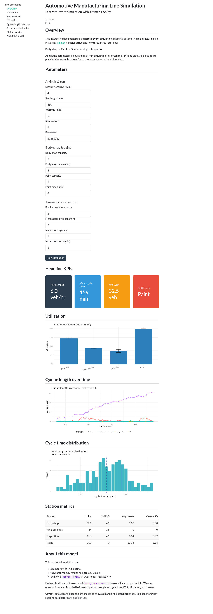

# Automotive Line Simulation

Discrete-event simulation of a serial automotive manufacturing line, written in R with [simmer](https://r-simmer.org/). Vehicles arrive and flow through four stations in order:

**Body shop → Paint → Final assembly → Inspection**

The same line is available three ways: a batch script that writes metrics and plots, an interactive [Shiny](https://shiny.posit.co/) app, and a [Quarto](https://quarto.org/) document with `server: shiny`. This repository is the portfolio foundation. The model runs; later polish (real station data, shifts, breakdowns, rework, scenario comparison) is listed under [Roadmap](#roadmap).

> **Placeholder example values.** Every capacity, cycle time, and arrival rate shipped here is an example chosen so the demo stays fast and shows a clear paint bottleneck. These are not real plant data. Replace them with measured station data before using any result to make a decision.

## Live demos

| Surface | Link |
| --- | --- |
| Shiny app | <https://2o6mmo-eddie-benjamin.shinyapps.io/automotive-line-sim/> |
| Quarto document | <https://2o6mmo-eddie-benjamin.shinyapps.io/automotive-line-sim-quarto/> |


*Deployed Shiny app, placeholder defaults (5 replications, base seed 20261027). The same capture is also saved as `docs/images/app_screenshot.png`.*

## What the model does

Arrivals are exponential. Each station has a configurable number of parallel bays and a service-time distribution (exponential, or normal floored at 0.1 minutes). A vehicle seizes a bay, holds it for the drawn service time, releases it, and moves to the next station.

Each replication sets its own seed (`base_seed + replication - 1`) so a run is reproducible and safe to execute independently. Statistics are computed after a warmup window is discarded:

- Completions and throughput use arrivals that started at or after warmup and finished inside the horizon.
- Utilization and queue length are time-weighted from the resource monitor.
- Work-in-process is the sum across stations of average busy servers plus average queue.
- The bottleneck is the station with the highest mean utilization across replications.

Queue and WIP charts use every replication. Simmer’s resource monitor is a step function at irregular event times, so each series is carried forward onto a common grid (2 minutes) before a loess smooth is fit. The raw monitor for every replication is still in the result.

Placeholder defaults:

| Station | Bays | Distribution | Mean (min) | SD (min) |
| --- | ---: | --- | ---: | ---: |
| Body shop | 2 | exponential | 6 | — |
| Paint | 1 | normal | 8 | 1.5 |
| Final assembly | 2 | normal | 7 | 1.0 |
| Inspection | 1 | exponential | 3 | — |

Mean interarrival time is 4 minutes. The horizon is 480 minutes with 60 minutes of warmup. The app and Quarto doc default to 5 replications; the batch script defaults to 10. Base seed is `20261027`.

## Features

- Serial four-station line with parallel bays and configurable service distributions.
- Multiple independent replications with fixed, per-replication seeds.
- Warmup discard before KPI calculations.
- Interactive controls for arrival rate, horizon, warmup, replication count, seed, capacity, and mean service time.
- Headline KPI cards and a station metrics table.
- All-replication charts: jittered utilization points with the mean and SD; queue length and WIP as a faint line per replication plus a bold loess trend and ribbon; cycle time as faint per-replication densities plus the pooled density.
- CSV download for the data behind every plot, and a **Download all (zip)** bundle (`zip` package).
- Batch run that writes those CSVs, the zip, and four PNG figures.
- Self-contained `app/` and `quarto/` directories, each publishable with `rsconnect` on its own.

## KPIs

| KPI | Definition in this model |
| --- | --- |
| Throughput | Completed vehicles per hour after warmup |
| Cycle time | Departure time minus arrival time; mean, and p50 / p90 / p95. The chart shows a density for each replication and a pooled density |
| Average WIP | Time-weighted vehicles on the floor (in service and in queue), and WIP over time for every replication |
| Queue length | Time-weighted queue at each station, and queue over time for every replication |
| Utilization | Time-weighted busy servers / capacity. The chart shows one point per replication, with the across-rep mean and SD |
| Bottleneck | Station with the highest mean utilization |

### Example plots

These figures are the batch script’s placeholder run (10 replications). Each chart draws every replication, then the across-replication summary. Regenerating them writes new files under `output/`, which is gitignored; the copies below are the committed examples.


### Exports

The Shiny sidebar and the Quarto document each have a button for the tidy table behind a plot, plus **Download all (zip)**. The batch script writes the same files to `output/` and bundles them as `output/sim_exports.zip`.

| File | Contents |
| --- | --- |
| `queue_timeseries.csv` | Resampled queue and server count by replication, seed, station, and time |
| `wip_timeseries.csv` | Resampled WIP by replication, seed, and time |
| `utilization_by_rep.csv` | Time-weighted utilization, queue, and servers for each replication and station |
| `cycle_times.csv` | One row per completed vehicle: replication, seed, vehicle id, start, end, cycle time |
| `station_metrics.csv` | Across-replication mean and SD of utilization and average queue |
| `run_parameters.csv` | Horizon, warmup, arrival rate, seed, replication count, grid step, and each station’s capacity and service distribution |

The zip also includes `summaries.csv` (throughput, cycle-time quantiles, and average WIP for each replication). Individual download buttons cover the six tables above. `run_line_sim()` returns those tables directly, along with the raw all-replication resource monitor.

### Quarto document

The Quarto doc is the same simulation as a single scrolling report. Because it uses `server: shiny`, the live copy is hosted on shinyapps.io.



## Tech stack

| Piece | Role |
| --- | --- |
| R 4.5 | Runtime |
| [simmer](https://r-simmer.org/) | Discrete-event engine |
| tidyverse | Wrangling and ggplot2 figures |
| tidymodels | Part of the stack for later modeling work. Runs today use simmer and tidyverse |
| shiny, bslib, bsicons | Interactive app (bslib theme, value boxes, icons) |
| DT | Station metrics table |
| zip | **Download all** bundle in the app and Quarto doc, and `sim_exports.zip` from the batch script |
| Quarto (`server: shiny`) | Interactive document |
| rsconnect | Deploy to shinyapps.io or Posit Connect |

## Run locally

Install the R packages once:

```r
install.packages(c(
  "simmer",
  "tidyverse",
  "tidymodels",
  "shiny",
  "bslib",
  "bsicons",
  "DT",
  "zip",
  "rsconnect"
))
```

Quarto CLI is required only for the document: <https://quarto.org/docs/get-started/>.

### Batch script

From the repository root:

```bash
Rscript scripts/manufacturing_sim.R
```

The script sources `app/R/model.R`, runs 10 replications, and writes:

- `output/queue_timeseries.csv`, `wip_timeseries.csv`, `utilization_by_rep.csv`, `cycle_times.csv`, `station_metrics.csv`, `run_parameters.csv`, and `summaries.csv`
- `output/sim_exports.zip`
- `output/utilization.png`, `queue_length.png`, `wip_over_time.png`, and `cycle_time_dist.png`

The `output/` directory is gitignored. The script resolves `output/` from its own path, so the working directory can be anywhere.

### Shiny app

```bash
cd app
Rscript -e 'shiny::runApp(".")'
```

Open the URL printed in the console. The app runs once on load, then again each time you press **Run simulation**.

### Quarto document

```bash
cd quarto
quarto preview line_sim.qmd
```

## Deploy

`app/` and `quarto/` each carry their own `R/model.R`, so either directory can be published on its own:

```r
# Shiny app — working directory app/
rsconnect::deployApp(appDir = ".", appName = "automotive-line-sim")

# Quarto doc — working directory quarto/
rsconnect::deployDoc("line_sim.qmd", appName = "automotive-line-sim-quarto")
```

Account setup, Posit Connect, and the Quarto CLI publish commands are in [DEPLOY.md](DEPLOY.md). Keep `rsconnect/` and any `.Renviron` / `.env` files out of git; they can hold account tokens.

If you change the simulation engine, copy it to both folders before the next publish:

```bash
cp app/R/model.R quarto/R/model.R
```

## Project structure

```text
app/
  app.R                 # bslib Shiny app
  R/model.R             # simmer engine (deployed with the app)
quarto/
  line_sim.qmd          # Quarto doc, server: shiny
  R/model.R             # same engine (deployed with the doc)
scripts/
  manufacturing_sim.R   # sources app/R/model.R; writes CSVs, zip, and PNGs
docs/images/            # app screenshots and all-replication example plots
DEPLOY.md               # shinyapps.io and Posit Connect notes
LICENSE                 # MIT, Eddie Benjamin, 2026
README.md
```

`scripts/manufacturing_sim.R` sources `app/R/model.R` (the copy next to the Shiny app). The app and the Quarto doc call `run_line_sim()` and `default_params()` from their own copy of `R/model.R`, and `write_sim_exports()` turns the result into the CSV files and the zip.

`run_line_sim()` returns tidy all-replication tables: `queue_timeseries`, `wip_timeseries`, `utilization_by_rep`, `cycle_times`, `station_metrics`, and `run_parameters`, plus per-replication summaries, the raw resource monitor for every replication, headline means and SDs, the bottleneck name, and the seeds that were used.

## Roadmap

- Replace placeholder capacities and cycle times with measured station data.
- Shift calendars, breaks, and planned downtime.
- Equipment breakdowns with MTBF and MTTR.
- Rework loops and scrap.
- Side-by-side scenario comparison (capacity, staffing, arrival rate).

## License

[MIT](LICENSE) © 2026 Eddie Benjamin.
